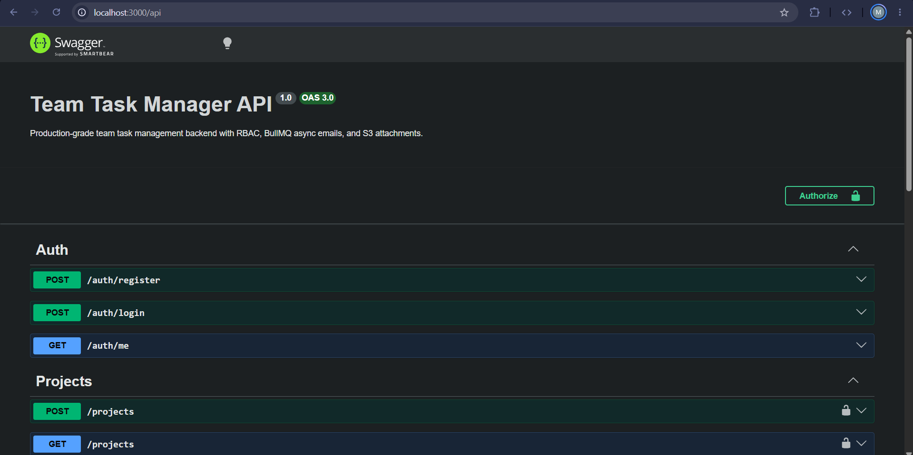

<p align="center">
  
</p>


</div>

---

## ویژگی‌های کلیدی و نکات مهندسی

- **احراز هویت JWT و ایمن‌سازی ورودی‌ها**
  - احراز هویت Stateless با JWT، هش کردن رمز عبور با `bcrypt` و استفاده از `JwtStrategy` در Passport.
  - فعال‌سازی `ValidationPipe` سراسری با تنظیم `whitelist: true` برای حذف فیلدهای اضافی و جلوگیری از حملات Mass Assignment.
- **کنترل دسترسی دو لایه بر اساس نقش (RBAC)**
  - استفاده از دکوریتور اختصاصی `@ProjectRoles()`، `Reflector` و `ProjectRolesGuard` برای تفکیک نقش‌های سطح سیستم (`ADMIN`، `USER`) از نقش‌های سطح پروژه (`MANAGER`، `MEMBER`).
  - محدود کردن کوئری‌های دیتابیس (`where: { id, projectId }`) برای جلوگیری از آسیب‌پذیری‌های IDOR بین پروژه‌های مختلف.
- **پردازش پس‌زمینه و غیرهمزمان (BullMQ + Redis)**
  - جداسازی زمان پاسخ‌دهی API ساخت تسک از تاخیر سرور SMTP با انتقال ایمیل‌های اطلاع‌رسانی به صف `email` روی Redis.
  - پیکربندی تلاش مجدد خودکار (`attempts: 3`) با تاخیر نمایی (**Exponential Backoff**) برای پایداری در برابر خطا.
- **آپلود امن فایل‌های پیوست روی فضای ابری (S3 + Presigned URLs)**
  - ذخیره فایل‌های باینری در باکت خصوصی S3 و نگهداری صرفاً متادیتا (`fileKey`، `mimeType`، `size`) در PostgreSQL.
  - تولید لینک دانلود امضاشده و موقت (**Presigned URL** با اعتبار ۱۵ دقیقه) پس از بررسی عضویت کاربر در پروژه.
- **مستندات تعاملی API**
  - مستندسازی کامل OpenAPI 3 از طریق Swagger UI در مسیر `/api` با پشتیبانی از نگهداری توکن JWT و فرم آپلود فایل.

---

## معماری سیستم

<div dir="ltr">

```text
Client (Swagger / Frontend)
        │
        ▼
[ NestJS API ] ──► ValidationPipe (DTOs) ──► JwtAuthGuard ──► ProjectRolesGuard
        │
        ├──► PostgreSQL (Prisma ORM)       — Users, Projects, Members, Tasks, Metadata
        ├──► Redis + BullMQ Worker         — Async Email Queue ──► SMTP (Mailpit)
        └──► S3 Storage (LocalStack/MinIO) — Private File Uploads & Presigned URLs


        لایه,تکنولوژی
فریم‌ورک,"NestJS, TypeScript"
دیتابیس و ORM,"PostgreSQL, Prisma 6"
احراز هویت و امنیت,"JWT (@nestjs/jwt), Passport, bcrypt, class-validator"
صف و پردازش پس‌زمینه,"BullMQ, Redis (ioredis), Nodemailer"
فضای ذخیره‌سازی ابری,"AWS SDK v3 (@aws-sdk/client-s3, @aws-sdk/s3-request-presigner)"
مستندسازی,Swagger / OpenAPI (@nestjs/swagger)
زیرساخت محلی,"Docker Compose (Postgres, Redis, S3, Mailpit)"

