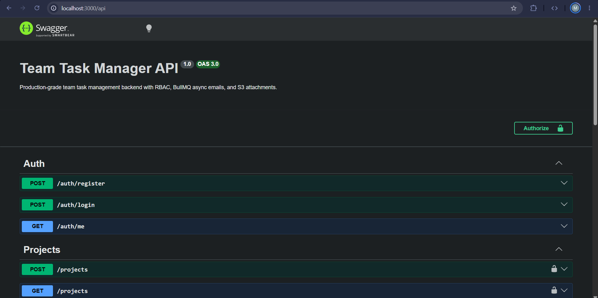

<p align="center">
  
</p>


# Team Task Manager API

A production-oriented, modular backend for team project and task management built with **NestJS**, **PostgreSQL (Prisma)**, **Redis (BullMQ)**, and **S3-compatible object storage**.

Designed with real-world backend architecture patterns: two-tier Role-Based Access Control (RBAC), asynchronous background job processing with retries, private cloud file storage via temporary Presigned URLs, and interactive OpenAPI (Swagger) documentation.


---

## Key Features & Engineering Highlights

- **JWT Authentication & Input Hardening**
  - Stateless JWT authentication with `bcrypt` password hashing and Passport `JwtStrategy`.
  - Global `ValidationPipe` with `whitelist: true` to strip unexpected properties and prevent mass-assignment attacks.
- **Two-Tier Role-Based Access Control (RBAC)**
  - Custom `@ProjectRoles()` decorator, `Reflector`, and `ProjectRolesGuard` separating system-wide roles (`ADMIN`, `USER`) from project-scoped roles (`MANAGER`, `MEMBER`).
  - Scoped database queries (`where: { id, projectId }`) to prevent IDOR (Insecure Direct Object Reference) vulnerabilities across projects.
- **Asynchronous Background Jobs (BullMQ + Redis)**
  - Decouples task creation from SMTP latency by offloading assignment notification emails to a dedicated Redis-backed `email` queue.
  - Configured with automatic retries (`attempts: 3`) and **exponential backoff** for fault tolerance.
- **Secure Cloud File Attachments (S3 + Presigned URLs)**
  - Stores binary files in private S3-compatible buckets while persisting only metadata (`fileKey`, `mimeType`, `size`) in PostgreSQL.
  - Generates time-limited **Presigned Download URLs** (15-minute expiry) after verifying project membership.
- **Interactive API Documentation**
  - Full OpenAPI 3 specification via Swagger UI (`/api`) with persistent JWT Bearer authorization and multipart file upload support.

---

## System Architecture

```text
Client (Swagger / Frontend)
        │
        ▼
[ NestJS API ] ──► ValidationPipe (DTOs) ──► JwtAuthGuard ──► ProjectRolesGuard
        │
        ├──► PostgreSQL (Prisma ORM)     — Users, Projects, Members, Tasks, Metadata
        ├──► Redis + BullMQ Worker       — Async Email Queue ──► SMTP (Mailpit)
        └──► S3 Storage (LocalStack/MinIO) — Private File Uploads & Presigned URLs


